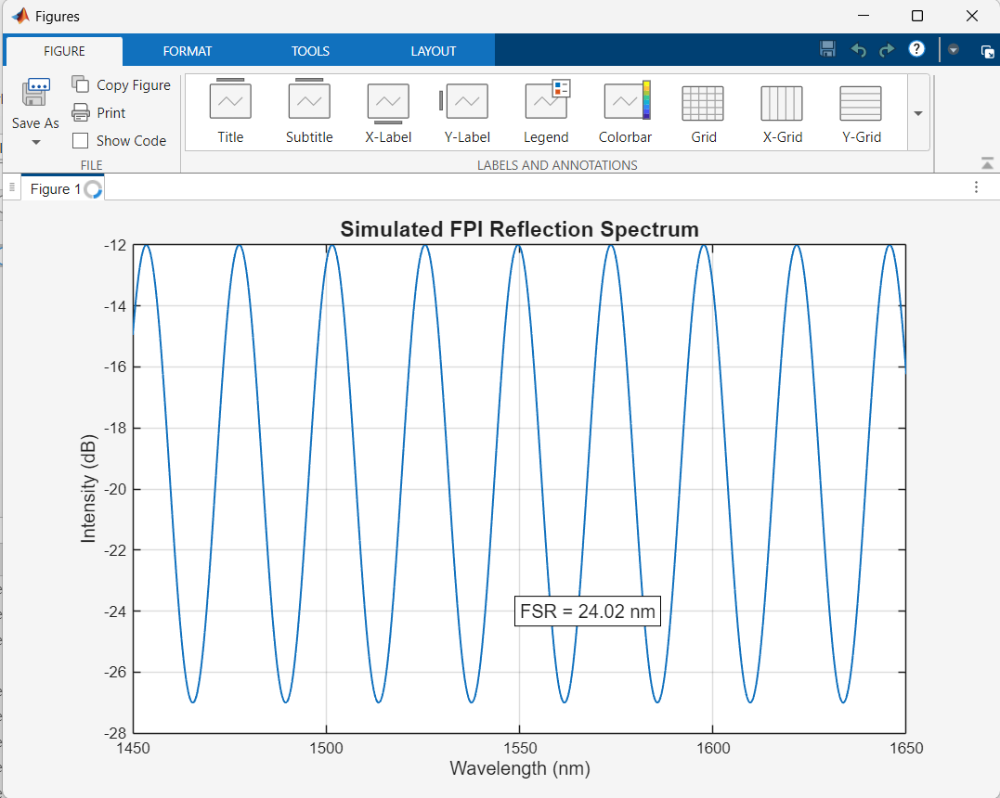

# Open-Cavity FPI Gas Pressure Sensor Simulation

This repository contains MATLAB simulation scripts and numerical modeling of an open-cavity Fabry-Pérot Interferometer (FPI) gas pressure sensor to enhance sensing performance.

## Simulation Results

- Developed with MATLAB for numerical modeling and optical signal spectrum analysis.
- Presented at NSYSU College of Engineering Student Poster Competition.
